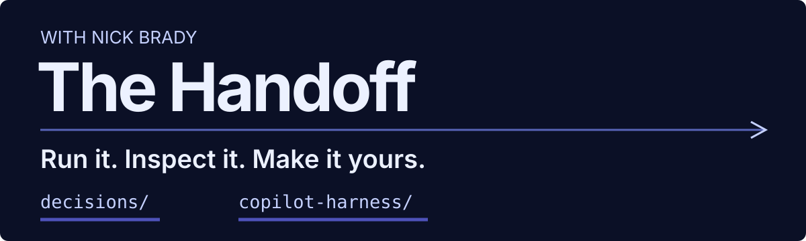
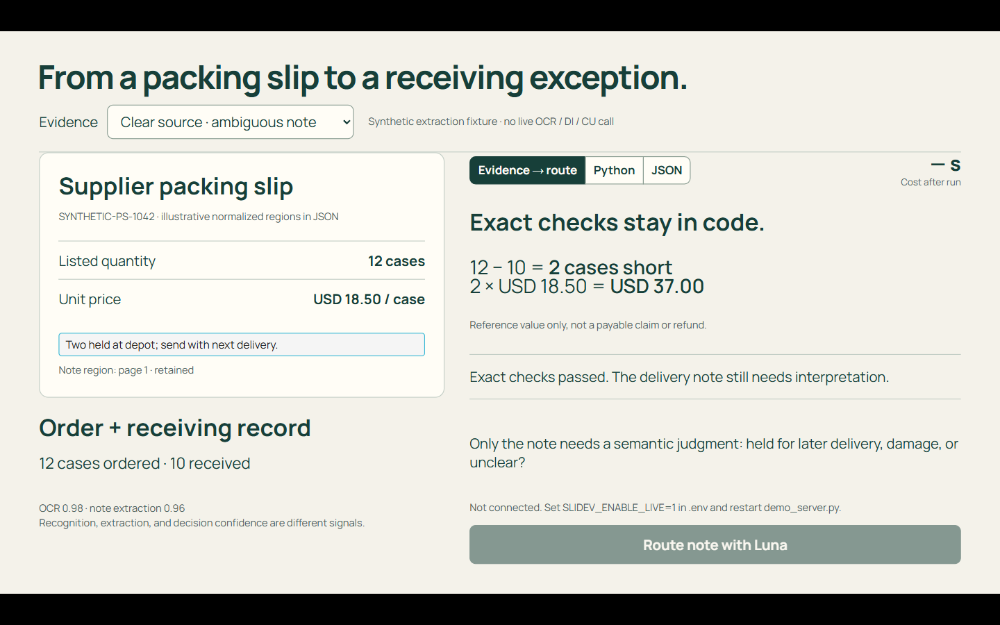
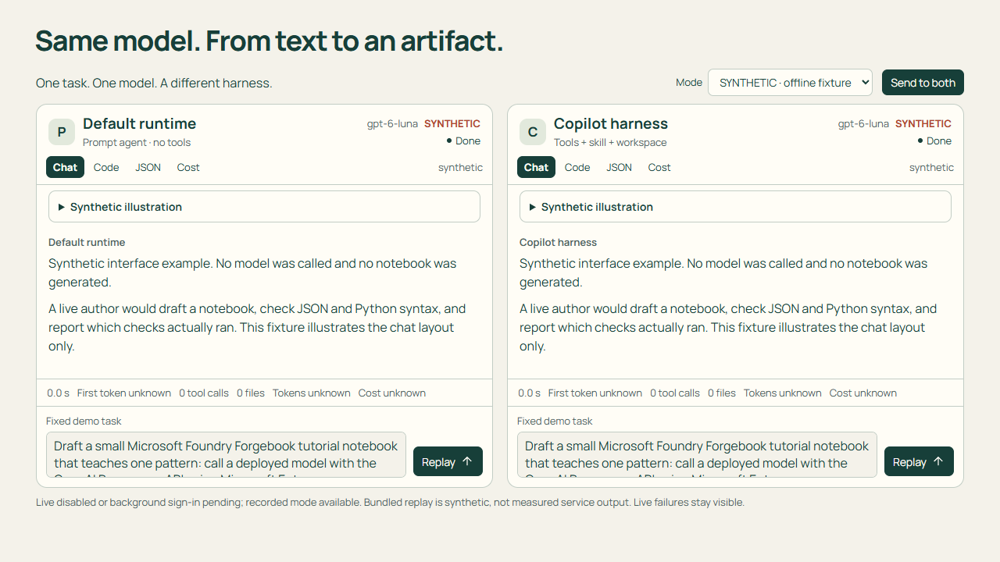

# Handoff demos

Run, inspect, and adapt the AI app and agent demos from **The Handoff with Nick
Brady**. This repository keeps the Slidev presentations and Python examples
together so you can reuse them for your own walkthrough.

**[Run your first demo](#run-your-first-demo)** · [Browse the demos](#browse-the-demos)



*A real local render of the Decisions deck. The packing slip is synthetic;
the exact checks run in code. The live model button is disabled.*



*The harness deck's portable replay. No model was called or artifact generated.*

## Browse the demos

| Demo | Try first | Cloud boundary |
| --- | --- | --- |
| [Decisions and agent OBO](decisions/README.md) | 28-slide deck or direct Python mock example | Live Decisions accepts Entra or a resource key. OBO requires delegated user sign-in and consent. |
| [Copilot harness](copilot-harness/README.md) | 20-slide deck with synthetic chat fixtures | Optional live recipe calls use Entra. Hosted runtimes and Fusion backend are not included. |
| [Weekly Foundry brief · Nov 9, 2026](weekly-brief/2026-11-06/README.md) | 25-slide news deck at port 3080 with notes and educational visuals | Captured demos show their actual status; optional fixed live runners require local opt-in and each demo's cloud prerequisites. |

Synthetic examples illustrate the interface. They are not measurements, service
recordings, completed agent work, or evidence that cloud access is configured.

## Run your first demo

You need Git and Node.js **22.12 or later**. Python **3.13** and
[`uv`](https://docs.astral.sh/uv/) are needed only for Python examples and adapters.

Clone this repository, or select **Fork** on GitHub and clone your fork instead.

```powershell
git clone https://github.com/nicholasdbrady/handoff-demos.git
Set-Location handoff-demos\copilot-harness
npm ci --registry=https://packagefeedproxy.microsoft.io/npm/
npm run dev
```

Open **http://127.0.0.1:3070**. Go to slide 12 and select **Send to both** to
replay the labeled synthetic chat fixtures. This first path needs no cloud
credentials and makes no inference calls. Stop the server with Ctrl+C.
After dependencies are installed, the presentation can run offline.

Commands below use PowerShell. On macOS or Linux, use `/` in paths and
`.venv/bin/python` instead of `.venv\Scripts\python.exe`.
Use your project package registry if configured; the commands show the fallback
feed used for this repository's setup.

## Present the slides

From the clone root, choose a deck:

```powershell
# Decisions: http://127.0.0.1:3030
Set-Location decisions\demos\livestream-updates
npm ci --registry=https://packagefeedproxy.microsoft.io/npm/
npm run dev
```

```powershell
# Copilot harness: http://127.0.0.1:3070
Set-Location copilot-harness
npm ci --registry=https://packagefeedproxy.microsoft.io/npm/
npm run dev
```

Add `/presenter` to either URL for speaker notes. The Decisions deck's live
panels need its Python adapter; static slides show backend-unavailable messages.
The harness deck defaults to synthetic offline fixtures.

## Run the Python example

Start with a Decisions mock. From the clone root:

```powershell
Set-Location decisions
uv venv --python 3.13 .venv
uv pip install --python .venv\Scripts\python.exe `
  --index-url https://packagefeedproxy.microsoft.io/pypi/simple `
  -r demos\livestream-updates\requirements.txt `
  -r demos\agent-obo-tools\requirements.txt
.\.venv\Scripts\python.exe -X utf8 demos\decisions-api\decisions_factory.py --mock --step predicate
```

The output says **MOCK**. It uses synthetic answers and sends no cloud request.
The [Decisions guide](decisions/README.md) includes offline OBO examples and
separate commands for live operation. The [harness guide](copilot-harness/README.md)
includes its direct Python probe and agent factory.

## Configure your own services

Copy the example beside the program you will run, then edit the resulting `.env`:

| Program | Configuration example |
| --- | --- |
| Decisions slides and adapter | [`decisions\demos\livestream-updates\.env.example`](decisions/demos/livestream-updates/.env.example) |
| Direct Decisions Python | [`decisions\demos\decisions-api\.env.example`](decisions/demos/decisions-api/.env.example) |
| Direct OBO Python | [`decisions\demos\agent-obo-tools\.env.example`](decisions/demos/agent-obo-tools/.env.example) |
| Harness Python and adapter | [`copilot-harness\.env.example`](copilot-harness/.env.example) |

For example:

```powershell
# From the clone root
Copy-Item copilot-harness\.env.example copilot-harness\.env
```

**Resource endpoint and project endpoint are different.** Decisions uses
`AZURE_OPENAI_ENDPOINT` and an optional `AZURE_OPENAI_API_KEY`. Harness uses
`AZURE_AI_PROJECT_ENDPOINT` with Entra credentials; it does not support API-key
authentication. OBO needs user identity and consent even when model calls use a
key. Each guide lists required, optional, and setup-only values.

Use your own existing Azure resources, compatible deployments, permissions, and
quota. Live model calls and tools can incur charges. Preview support varies.
Cloud setup scripts can change agents and authorization; review them before
running them. These quickstarts do not provision infrastructure.

Keep `.env`, sign-in data, captures, and runtime logs out of Git. Do not put
secrets in `VITE_*` variables or expose the loopback adapters with a public tunnel.
Generated notebooks must not execute live cloud calls during authoring checks.

## Reuse a demo

Keep each demo's source, notes, environment example, and tests together.
Add future broadcasts to the relevant folder instead of creating a weekly
repository. Label synthetic inputs and playback. Show live failures rather than
substituting successful-looking output.

This is the runnable companion to the show, not a Microsoft support channel.
Microsoft Foundry is the subject; the project does not imply corporate
endorsement. Recording and community links will be added when verified.

## License and credits

The cleared demo source is [MIT licensed](LICENSE), copyright Nick Brady.
Third-party assets and dependencies retain their own terms.
See [source and asset notices](NOTICE.md) for import provenance, photograph
credits, and synthetic-image disclosures.
