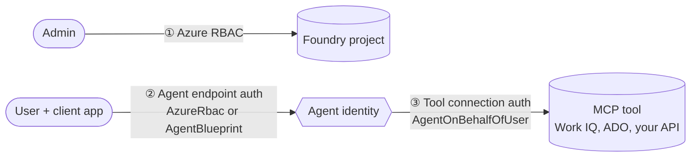
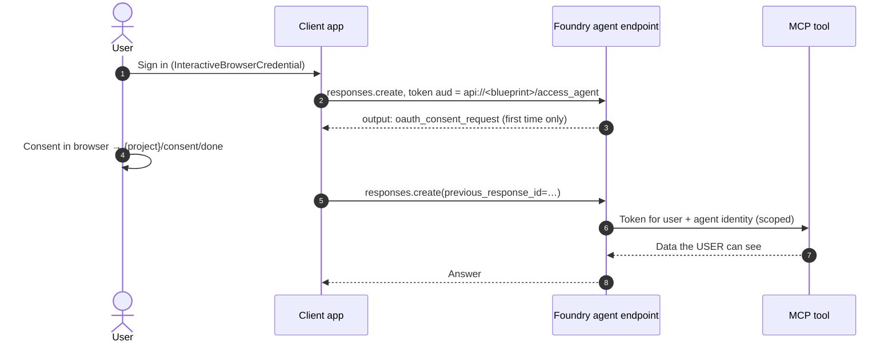

# Agent on-behalf-of-user (OBO) for tool connections — demo

**Preview.** A Foundry agent calls a downstream tool **as the agent, on behalf of the signed-in user**.
The tool gets a token that represents both. The user's permissions and Conditional Access apply.
The agent has no standing access of its own.

Docs:
[Identity and access overview](https://learn.microsoft.com/azure/foundry/agents/concepts/identity-access-overview) ·
[Configure user delegation](https://learn.microsoft.com/azure/foundry/agents/how-to/configure-user-delegation) ·
[MCP authentication](https://learn.microsoft.com/azure/foundry/agents/how-to/mcp-authentication)

## The one idea: three separate boundaries

Permission never flows across a boundary by itself. Each one is configured on its own.



| Boundary | Question it answers | Where you set it |
|---|---|---|
| ① Admin → Foundry | Who can build and manage agents? | Azure RBAC on the project |
| ② Caller → agent | Who can call this agent, and with which token audience? | `agent_endpoint.authorization_schemes` |
| ③ Agent → tool | Whose identity reaches the tool? | The connection `authType` |

## Pick the right tool auth type

| `authType` | Who is the actor at the tool | Use it when |
|---|---|---|
| `UserEntraToken` | Depends on the caller token. Foundry audience → **Foundry**. Agent audience → **agent identity**. | Listed Microsoft tools only. Default scopes. |
| **`AgentOnBehalfOfUser`** (preview) | **Always the agent identity**, on behalf of the user | You want a user+agent token every time. Custom MCP servers. Explicit scopes. |
| `OAuth2` | The user, through an in-conversation sign-in | Third-party OAuth services |
| Managed identity / key | The agent or project, with **no** user | Shared, non-personal data |

Rules for `AgentOnBehalfOfUser`:

- The agent endpoint must enable the **`AgentBlueprint`** scheme. Callers get a token for `api://<blueprint-client-id>/access_agent`.
- One connection = **one downstream resource**. Scopes are **fully qualified** (no `.default`).
- The user consents to the downstream scopes once, either in the flow or through admin consent.

## Flow



## Files

| File | Purpose |
|---|---|
| `agent_obo_factory.py` | Setup: connection (optional ARM PUT), prompt agent with `MCPTool`, endpoint `AzureRbac` + `AgentBlueprint` |
| `obo_client.py` | Runtime: user sign-in, caller-token claims, consent round-trip, answer. `--audience foundry` shows the contrast. |

Both scripts support `--mock`, which runs the full flow offline.

## Prerequisites

This scenario requires Microsoft Entra authentication. An Azure OpenAI model
API key does not identify a user and cannot replace delegated sign-in or
consent. Setup uses Azure RBAC through `DefaultAzureCredential`; runtime uses
`InteractiveBrowserCredential` for the agent blueprint audience. The Slidev
model demos can use a key independently of this OBO scenario.

1. A Foundry project and a model deployment.
2. An Entra-protected MCP server and its delegated scope. Supported examples:

   | Tool | Scope |
   |---|---|
   | Work IQ User tool | `api://ea9ffc3e-8a23-4a7d-836d-234d7c7565c1/McpServers.Me.All` |
   | Work IQ MCP (`AgentOnBehalfOfUser` only) | `api://workiq.svc.cloud.microsoft/WorkIQAgent.Ask` |
   | Azure DevOps MCP | `api://2a72489c-aab2-4b65-b93a-a91edccf33b8/Ado.Mcp.Tools` |
   | Foundry MCP | `https://mcp.ai.azure.com/Foundry.Mcp.Tools` |

   Work IQ MCP uses the Work IQ API through Copilot Credits billing. `WorkIQAgent.Ask`
   requires tenant admin consent and can authorize read/write access. This demo limits
   the agent to the read-only `fetch` tool and the `/me` profile path.
   Work IQ MCP endpoint: `https://workiq.svc.cloud.microsoft/mcp`. The similar-looking
   `https://workiq.svc.cloud.microsoft/a2a/` URL is for the separate A2A integration.
   The sample defaults to the documented MCP endpoint; override it only when the target service documents a different one.
3. A **public client app registration** for the caller:
   - Redirect URI `http://localhost` (Mobile and desktop applications).
   - Delegated API permission `access_agent` on the agent blueprint. You add this after setup step 3 prints the blueprint client ID.
4. Two test users, so you can show per-user isolation.

## Setup

```powershell
Copy-Item demos\agent-obo-tools\.env.example demos\agent-obo-tools\.env   # then fill it in
$req = "demos\agent-obo-tools\requirements.txt"

# Dry run: print every request body
uv run --with-requirements $req python -X utf8 demos\agent-obo-tools\agent_obo_factory.py --mock

# Live. Add --create-connection to create the connection through ARM.
# If ARM rejects the preview authType, create the connection in the portal instead
# (Tools → Custom MCP → "Agent on behalf of user") and run without the flag.
uv run --with-requirements $req python -X utf8 demos\agent-obo-tools\agent_obo_factory.py --create-connection
```

Copy `AGENT_BLUEPRINT_CLIENT_ID` from the output into `.env`. Then grant the client app the `access_agent` permission.

## Run (on stream)

```powershell
# 1. The right way: agent-audience token → consent once → user's own data
uv run --with-requirements $req python -X utf8 demos\agent-obo-tools\obo_client.py

# 2. Run it again: no consent prompt this time
uv run --with-requirements $req python -X utf8 demos\agent-obo-tools\obo_client.py "Use fetch to read my job title from /me."

# 3. Sign in as a second user (use an InPrivate window): different data, same agent
# 4. Contrast: Foundry-audience token cannot produce a user+agent token for the tool
uv run --with-requirements $req python -X utf8 demos\agent-obo-tools\obo_client.py --audience foundry
```

Rehearse offline with `--mock` on any of these commands.

Use dedicated test identities for live runs. Work IQ can return real Microsoft 365 work context; do not expose a personal mailbox, calendar, files, or profile on stream.

## Talk track (about 10 minutes)

1. **Problem (1 min).** "Your agent needs my calendar, not everyone's. Today people hand agents a service account or a shared key. That's standing access."
2. **Three boundaries (2 min).** Show the first diagram. "Being allowed to call the agent does not give the agent your data. Each boundary is separate."
3. **Auth type table (1 min).** "`AgentOnBehalfOfUser` always makes the agent the actor, on behalf of the user. Your tool's audit log shows both identities."
4. **Setup (2 min).** Run `agent_obo_factory.py --mock`. Point at `authType`, the explicit `scopes`, and the two endpoint schemes. "Keep AzureRbac so the portal still works."
5. **Live call (2 min).** Run `obo_client.py`. Show the token claims: the audience is the **agent**, not Foundry. Consent once. Get the answer.
6. **Isolation (1 min).** Second user, same agent, different answer.
7. **Contrast (1 min).** `--audience foundry`. "Same user, wrong audience. The tool never sees a user+agent token."

## Preview caveats

- `AgentOnBehalfOfUser` and the `AgentBlueprint` endpoint scheme are in preview. Field names and portal labels can change.
- The `AgentBlueprint` scheme applies to **direct runtime clients**. The Foundry playground and Bot Service channels still use the Foundry audience.
- The endpoint PATCH replaces the full `authorization_schemes` array. Always send every scheme you want to keep.
- Do not log tokens or consent links. `obo_client.py` prints token **claims** only (audience, user, client, scopes).
- The ARM `api-version` for the preview authType can differ by region. Set `CONNECTION_API_VERSION`, or use the portal.

## Troubleshooting

| Symptom | Fix |
|---|---|
| `AADSTS65001` consent required at sign-in | Grant the client app the `access_agent` delegated permission on the blueprint. |
| `AADSTS50011` redirect URI mismatch | Add `http://localhost` as a Mobile and desktop redirect URI. |
| `401` from the agent endpoint | The `AgentBlueprint` scheme is not enabled, or `allowed_clients` does not include `CLIENT_APP_ID`. |
| Consent prompt every time | Consent did not finish. Wait for the `/consent/done` page, or use admin consent. |
| Tool returns `403` | The user lacks access in the downstream service, or a Conditional Access policy blocked the token. |
| Blueprint client ID not printed | Open the agent in the Foundry portal and copy it from the identity details. |
