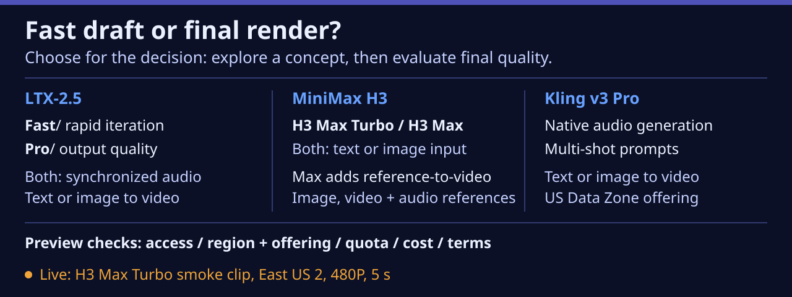

# fal video: fast draft or final render?

**Show the comparison and the real MiniMax H3 Max Turbo smoke clip.**
On Nov 9, 2026 (~2:50 PM PST) the subscription Owner registered
`Microsoft.CognitiveServices/Fal.EnableDeploy` and accepted fal's terms for
their organization. This demo accepted no terms. All five fal models are now
deployed in East US 2, and one live 5 s, 480P clip was generated with
MiniMax H3 Max Turbo. The manifest status is `partial`: one model has a real
sample; the other four are deployed but have no clip (no user approval yet).



## Presenter path

1. Show `public/demos/fal-video/comparison.svg`.
2. Ask: **When is a fast draft more useful than a higher-quality render?**
3. Compare Fast/Pro within LTX and H3 Max Turbo/Max within MiniMax. The visual
   shows documented differentiators, not measured speed or quality rankings.
4. Play `public/demos/fal-video/minimax-h3-max-turbo-smoke.mp4`
   (poster `minimax-h3-max-turbo-smoke.png`). Label it **generated by
   MiniMax H3 Max Turbo**. It is one smoke sample, not a benchmark.
5. Explain the gates: access/terms, region and offering, quota (RPM), cost.
6. Optional live run (about 47 s observed, about $0.13 estimated), only with
   a benign public prompt because the prompt goes to fal outside Microsoft
   facilities.

Fast drafts can answer a composition or motion question before committing to a
final render. That is a workflow recommendation, not a measured quality result.

## Real smoke-clip result

| Field | Value |
|---|---|
| Model / deployment | MiniMax H3 Max Turbo / `fal-minimax-h3-max-turbo` (East US 2, GlobalStandard) |
| Route | `POST /providers/falai/v1/minimax/h3-max-turbo/text-to-video` (Learn's `/v1/` example form worked first try) |
| Request | `duration: 5`, `resolution: "480P"`, `prompt_expansion_mode: "disabled"`, runner default prompt |
| Submitted / done | 2026-11-09 15:03:27 / 15:04:17 PST |
| End-to-end time | **46.8 s** (submit, queue, generate, download, ffprobe) |
| ffprobe | H.264 Constrained Baseline 832x480, yuv420p, 24 fps, 124 frames; AAC LC 32 kHz stereo; container 5.184 s; 2,042,222 bytes |
| Estimated cost | 5 s x $0.025/s = **$0.125**; about $0.13 if billed on the 5.184 s output |
| Request ID | **Not captured.** The runner did not emit it then; it now prints `request_id`. |

The clip ran 0.18 s longer than requested, consistent with Learn's note that
MiniMax output can run about 0.7 s long. It has an audio track. The published
MP4 is the unmodified download (SHA-256 in `evidence.json`); no transcode.
Azure Monitor showed 6 `SuccessfulCalls` at 23:04-23:05 UTC.
`FoundryModelEstimatedCost` had no data right after the run. No invoice yet.

## Created Azure resources (leave running for the show)

| Item | Value |
|---|---|
| Subscription | foundry-devx-sub (nbrady) |
| Resource group | `rg-handoff-fal-20261109` (East US 2, tag `handoff=2026-11-09`) |
| Foundry resource | `handoff-fal-20261109`, kind AIServices, S0, system identity, project management enabled, tag `handoff=2026-11-09` (mirrors `handoff-kimi-20261109`) |
| RBAC | Foundry User for the presenter, scoped to this resource only |

| Deployment | Model (version 2026-11-02, format fal.ai) | SKU | Capacity | State |
|---|---|---|---|---|
| `fal-kling-v3-pro` | Fal-Kling-V3-Pro | DataZoneStandard | 40 | Succeeded |
| `fal-ltx-2-5-fast` | Fal-LTX-2.5-Fast | GlobalStandard | 40 | Succeeded |
| `fal-ltx-2-5-pro` | Fal-LTX-2.5-Pro | GlobalStandard | 40 | Succeeded |
| `fal-minimax-h3-max` | Fal-MiniMax-H3-Max | GlobalStandard | 40 | Succeeded |
| `fal-minimax-h3-max-turbo` | Fal-MiniMax-H3-Max-Turbo | GlobalStandard | 40 | Succeeded |

**Capacity 40 = 40 requests per minute, not 40,000 TPM.** Each deployment
reports `rateLimits: [{key: "request", count: 40, renewalPeriod: 60}]`,
matching Learn's tier 5-7 RPM. There are no token units for these models.
Each deployment finished in seconds via `az cognitiveservices account
deployment create` (ARM/CLI supports format `fal.ai`).

Cleanup, only after the presenter approves (deletes only the new group):

```powershell
az group delete --name rg-handoff-fal-20261109 --subscription "foundry-devx-sub (nbrady)" --yes
```

## Official evidence and prices

Sources retrieved **2026-11-09** (~00:40 PST; retail meters ~15:10 PST).

- [Nov 5 Microsoft announcement](https://techcommunity.microsoft.com/blog/azure-ai-foundry-blog/building-the-next-generation-of-multimodal-ai-experiences-with-fal-in-microsoft-/4570032).
  It is on Tech Community, **not** `devblogs.microsoft.com/foundry`.
- [Microsoft Learn: enable, deploy, APIs, settings, quota, and terms](https://learn.microsoft.com/azure/foundry/how-to/fal-ai-models/enable-fal-models).
- [Foundry model catalog](https://ai.azure.com).
- [Kling public schema](https://fal.ai/api/openapi/queue/openapi.json?endpoint_id=fal-ai/kling-video/v3/pro/text-to-video).
- [Azure Retail Prices API, `Azure Fal` in East US 2](https://prices.azure.com/api/retail/prices?$filter=productName%20eq%20'Azure%20Fal'%20and%20armRegionName%20eq%20'eastus2').

**Pricing unit:** the launch prose says USD per minute, but its table heading
says **per video second**. The Azure Retail Prices API lists `Azure Fal`
meters with `unitOfMeasure: "1 Second"` and values equal to the table (for
example, `Fal Test MM H3 Mx Trb Txt-Vd 480 Video` = 0.025 USD in eastus2,
effective 2026-10-01). This supports per-second billing. Caveats: the meter
names start with "Fal Test", no Kling meter was listed, and no invoice exists
yet. Prices stay out of the on-screen visual; keep them in presenter notes.

| Model | Offering | USD per video second (launch table; LTX/MiniMax match retail meters) | Small request at that rate |
|---|---|---|---|
| Kling v3 Pro | US Data Zone | Audio off 0.1232; on 0.1848; audio + voice control 0.2156 | 5 s, audio off: $0.616 |
| LTX-2.5 Fast | Global Standard PayGo | 720p 0.09; 1080p 0.13; 1440p 0.19; 4K 0.30 | 720p, 6 s: $0.54 |
| LTX-2.5 Pro | Global Standard PayGo | 720p 0.12; 1080p 0.17 | 720p, 6 s: $0.72 |
| MiniMax H3 Max | Global Standard PayGo | 480P 0.05; 768P 0.08; 1080P 0.16 | 480P, 5 s: $0.25 |
| MiniMax H3 Max Turbo | Global Standard PayGo | 480P 0.025; 768P 0.04; 1080P 0.08 | 480P, 5 s: **$0.125 (generated)** |

Learn calls these LTX **v2.5**; the announcement uses **LTX-2.5**.
Kling accepts 3-15 seconds; its schema does not specify resolution or fps.
LTX starts at **6** seconds. Fast supports higher resolutions and longer clips;
Pro tops out at 10 seconds. MiniMax supports 0.92-15 seconds, defaults to
768P/5 s, and 1080P uses latent refinement from 768P. Only H3 Max adds
reference-to-video. Both LTX variants support synchronized audio.

**Regions observed in this subscription's catalog (format fal.ai, version
2026-11-02):** East US 2 has all five; Sweden Central has four (no Kling);
East US and North Central US have none. This is one subscription's view, not
a complete supported-region list.

**Data handling:** Learn says fal services operate outside Microsoft
facilities, and Microsoft customer agreements, DPA, and certifications do not
apply. Send only benign public prompts. No organizational data was sent.

## Live run

### Portable environment contract

The illustration, clip, poster, and evidence are static public files and need
**no cloud credentials**. The runner reads server-side process environment
first, then `demos/fal-video/.env`, then the presentation root `.env`; earlier
values win. Never use `VITE_` variables for these.

| Name | Default | Meaning / blocker |
|---|---|---|
| `FOUNDRY_RESOURCE_ENDPOINT` | Unset | `https://<resource>.services.ai.azure.com` root (show resource: `https://handoff-fal-20261109.services.ai.azure.com`) |
| `FAL_ACCESS_CONFIRMED` | False | Set `true` only when the subscription has fal registered and deployments exist; does not grant access |
| `FAL_DEPLOYMENTS` | `{}` | JSON map of runner slugs to exact deployment names; missing model is unavailable |
| `FAL_PRICES_PER_SECOND_USD` | `{}` | JSON map of slugs to positive USD/video-second rates at the runner's settings; missing rate blocks before a paid request |

Auth: `DefaultAzureCredential`, scope
`https://cognitiveservices.azure.com/.default` (Azure CLI sign-in locally).
The identity needs Foundry User on the resource. No key is used.
Other blockers: `ffprobe` not on PATH, HTTP/auth failure, 429 when over
40 RPM, and failed or timed-out remote jobs.

### Run

1. Install Python 3.12+, `uv`, Azure CLI, and FFmpeg (`ffprobe` on PATH; on
   Windows `winget install Gyan.FFmpeg`, then open a new shell).
2. `az login` as an identity with Foundry User on the resource.
3. From `weekly-brief/2026-11-06`, copy `demos/fal-video/.env.example` to
   `demos/fal-video/.env` (gitignored) and fill in the values.
4. Run:

```powershell
uv run demos/fal-video/run.py --json
uv run demos/fal-video/run.py --json --model minimax-h3-max-turbo --prompt "A plain notebook on an empty desk at dawn, gentle steam, slow camera push. No people, readable text, logos or brands."
```

Command-scoped feed fallback: `$env:UV_DEFAULT_INDEX = "https://packagefeedproxy.microsoft.io/pypi/simple"`.

The default model is the first configured in this order: MiniMax H3 Max
Turbo (live-verified, lowest rate), LTX Fast, LTX Pro, H3 Max, Kling. This is
a preference, not a measured latency ranking. The runner sends one request,
polls up to 15 minutes, downloads to the gitignored `public/demos/fal-video/live/`,
measures with ffprobe, and prints one JSON object with `ok`, `model`,
`deployment`, `request_id`, `prompt`, `seconds`, `video_path`, `width`,
`height`, `duration_s`, `fps`, `file_mb`, `est_cost_usd`. Cost is requested
seconds x configured rate, not an invoice. Errors print `ok:false` with null
metrics and exit 1; **no recording fallback exists**. A poll timeout can leave
a billed job running; inspect before retrying. Azure bearer tokens are never
sent to third-party storage links or redirects.

Only the MiniMax H3 Max Turbo path has run live. The LTX, H3 Max and Kling
payloads follow Learn and the Kling schema but are unverified live.

## Assets and validation

Under `public/demos/fal-video/`:

- `minimax-h3-max-turbo-smoke.mp4` (2.04 MB) and `.png` poster (2.5 s frame):
  real model output.
- `comparison.svg`: 1280x480 authored infographic, **not** model output.
  Handoff navy/cobalt, IBM Plex Sans (Segoe UI fallback), text >= 24px.
- `manifest.json`, `evidence.json`.

Offline tests (no auth, no paid calls):

```powershell
uv run --with azure-identity --with httpx --with python-dotenv python -m unittest discover -s demos/fal-video -p "test_*.py"
```
